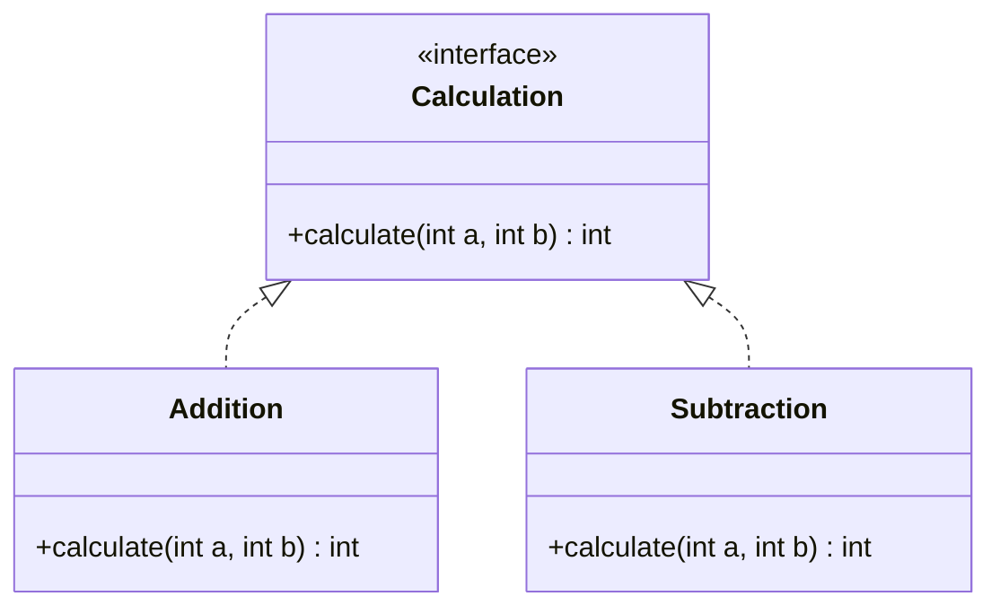
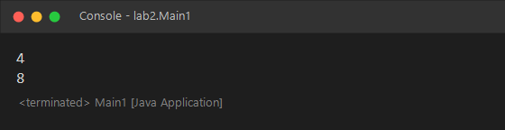
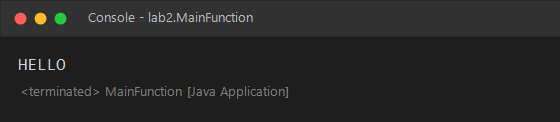

<div align="center">

# ⚡ Functional Interfaces

### Lab 2 — Advanced Java Development

*Functional interfaces · Anonymous classes · Lambda expressions · `java.util.function`*


**EMSI · 4IIR · Advanced Java Development**

</div>

---

## 📑 Table of Contents

- [🎯 Objectives](#-objectives)
- [🧩 Design Overview](#-design-overview)
- [🗂️ Project Structure](#️-project-structure)
- [🧰 Prerequisites](#-prerequisites)
- [🚀 Create the Project in Eclipse (step by step)](#-create-the-project-in-eclipse-step-by-step)
- [📥 Or Import the Existing Project](#-or-import-the-existing-project)
- [▶️ Run the Programs](#️-run-the-programs)
- [📸 Results](#-results)
- [🛠️ Troubleshooting](#️-troubleshooting)
- [🧠 Key Takeaways](#-key-takeaways)

---

## 🎯 Objectives

- ✅ Define a **functional interface** (an interface with exactly one abstract method)
- ✅ Implement it in three different ways: **named class**, **anonymous class**, **lambda expression**
- ✅ Use a ready-made functional interface from the JDK: `java.util.function.Function`
- ✅ Understand how a project declares itself with a `module-info.java`

---

## 🧩 Design Overview



| Technique | Where | Operation |
|---|---|---|
| 🏷️ Named class | `Addition`, `Subtraction` | `a + b`, `a - b` |
| 👤 Anonymous class | `Main1` | division `a / b` |
| ➡️ Lambda expression | `Main1` | multiplication `(a, b) -> a * b` |
| 🔧 `Function<T, R>` | `MainFunction` | upper-case a `String` (null-safe) |

---

## 🗂️ Project Structure

```text
FunctionalInterfaceDemo/
├── 📁 src/
│   ├── 📄 module-info.java            ← module descriptor
│   └── 📁 lab2/
│       ├── 📄 Calculation.java        ← the functional interface
│       ├── 📄 Addition.java           ← named implementation
│       ├── 📄 Subtraction.java        ← named implementation
│       ├── 📄 Main1.java              ← anonymous class + lambda
│       └── 📄 MainFunction.java       ← java.util.function.Function
├── 📁 docs/images/                    ← screenshots used in this README
├── ⚙️ .classpath
├── ⚙️ .project
└── 📁 .settings/
```

---

## 🧰 Prerequisites

| Requirement | Version | Notes |
|---|---|---|
| ☕ **JDK** | **17 or later** | Lambdas need Java 8+, modules need Java 9+ |
| 🌙 **Eclipse IDE** | *Eclipse IDE for Java Developers* | [Download](https://www.eclipse.org/downloads/) |

---

## 🚀 Create the Project in Eclipse (step by step)

### Step 1 — Create a new Java project
```text
File ▸ New ▸ Java Project
```

| Field | Value |
|---|---|
| **Project name** | `FunctionalInterfaceDemo` |
| **Use default location** | ✔ checked |
| **JRE** | *Use default JRE* (JDK 17+) |
| **Create module-info.java file** | ✔ **checked** (this project uses one) |

Click **Finish**. If Eclipse asks for a module name, accept the default (`FunctionalInterfaceDemo`).

> 💡 You may leave **module-info.java** unchecked if you prefer a plain project: the code works identically either way.

### Step 2 — Create the package
Right-click `src`:
```text
New ▸ Package   →   lab2
```

### Step 3 — Create the interface
Right-click the `lab2` package:
```text
New ▸ Interface   →   Name: Calculation
```
```java
package lab2;

public interface Calculation {
    int calculate(int a, int b);
}
```

### Step 4 — Create the implementations
Right-click `lab2` ▸ **New ▸ Class**, then create:

- `Addition` (implements `Calculation`) → returns `a + b`
- `Subtraction` (implements `Calculation`) → returns `a - b`

> 🪄 In the **New Java Class** wizard, click **Add…** next to *Interfaces* and pick `Calculation`: Eclipse generates the method stub for you.

### Step 5 — Create the two runnable classes
Create `Main1` and `MainFunction` the same way, ticking
**☑ public static void main(String[] args)**, then paste the code.

### Step 6 — Save and build
Press `Ctrl + S`. The **Problems** tab should be empty.

---

## 📥 Or Import the Existing Project

```text
File ▸ Import ▸ General ▸ Existing Projects into Workspace
```
Browse to the `FunctionalInterfaceDemo` folder ▸ tick the project ▸ **Finish**.

---

## ▶️ Run the Programs

1. Open `Main1.java` (or `MainFunction.java`).
2. **Run ▸ Run As ▸ Java Application** — or press **`Ctrl + F11`**.
3. Read the result in the **Console** view.

Command-line alternative:

```bash
javac -d bin src/module-info.java src/lab2/*.java
java -p bin -m FunctionalInterfaceDemo/lab2.Main1
```

---

## 📸 Results

### `Main1` — anonymous class and lambda

```java
// anonymous class
Calculation division = new Calculation() {
    @Override
    public int calculate(int a, int b) { return a / b; }
};
System.out.println(division.calculate(8, 2));        // 4

// lambda expression
Calculation multiplication = (a, b) -> a * b;
System.out.println(multiplication.calculate(4, 2));  // 8
```

<p align="center"></p>

### `MainFunction` — `java.util.function.Function`

```java
Function<String, String> uppercase =
        text -> (text == null) ? "" : text.toUpperCase();
System.out.println(uppercase.apply("hello"));
```

<p align="center"></p>

---

## 🛠️ Troubleshooting

| Problem | Solution |
|---|---|
| ❌ *"Unbound JRE / JavaSE-26 not found"* | The project was created with a newer JDK. `Right-click project ▸ Properties ▸ Java Build Path ▸ Libraries` → remove the broken JRE → **Add Library ▸ JRE System Library ▸ Workspace default JRE**. |
| ❌ *"Lambda expressions are not supported at this language level"* | `Project ▸ Properties ▸ Java Compiler` → set the compliance level to **17** or higher. |
| ❌ Error in `module-info.java` | Make sure the module name matches the project, or delete `module-info.java` (right-click ▸ Delete) — nothing else depends on it. |
| ❌ `ArithmeticException: / by zero` | `Main1` divides integers; never pass `0` as the second argument of the division. |

---

## 🧠 Key Takeaways

- 🔹 A **functional interface** has exactly **one abstract method**; this is what makes lambdas possible.
- 🔹 A lambda `(a, b) -> a * b` is a compact replacement for an anonymous class.
- 🔹 The JDK already provides many functional interfaces in `java.util.function` (`Function`, `Predicate`, `Consumer`, `Supplier`, …) — use them before writing your own.
- 🔹 Annotating an interface with `@FunctionalInterface` makes the compiler enforce the one-method rule.

---

<div align="center">

Made with ☕ and 💡 for the **Advanced Java Development** course — EMSI

</div>
